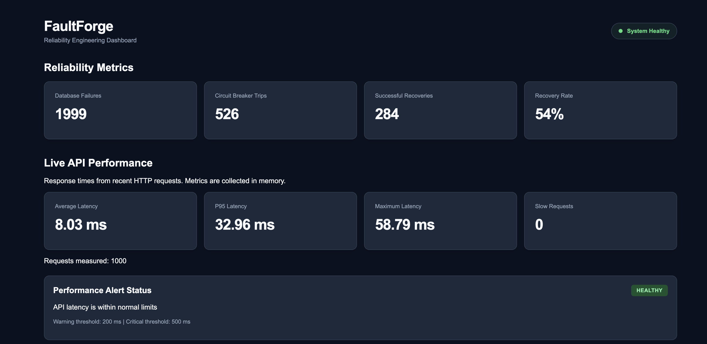
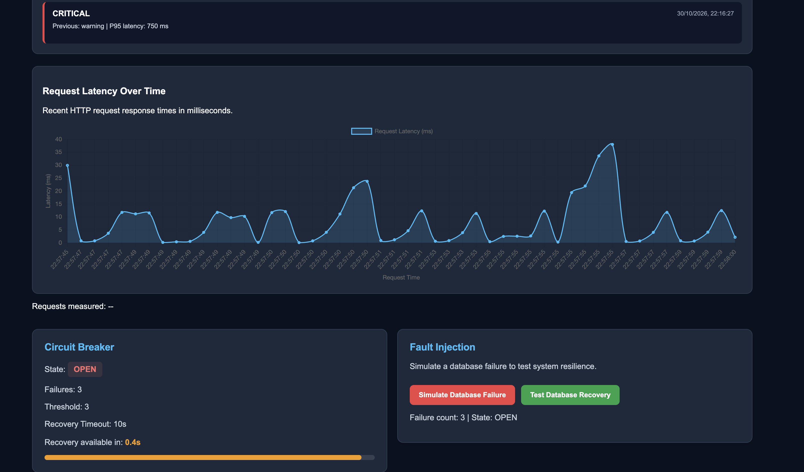
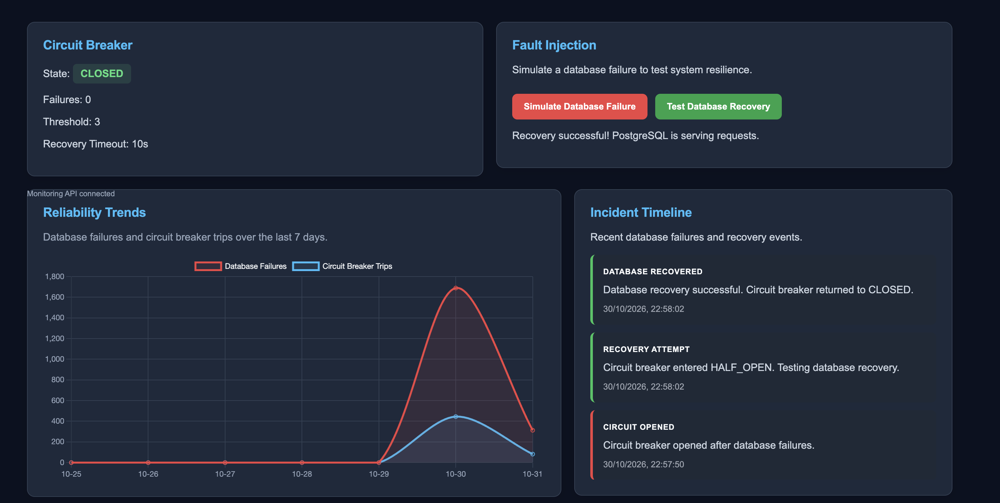
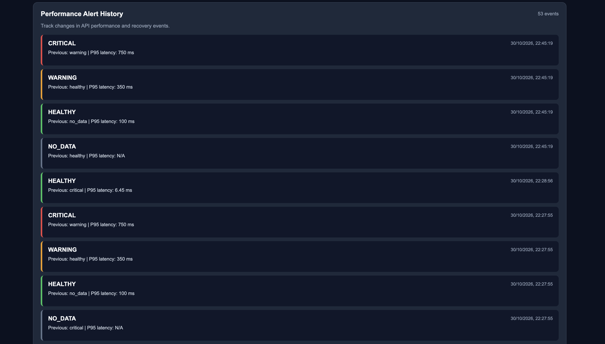
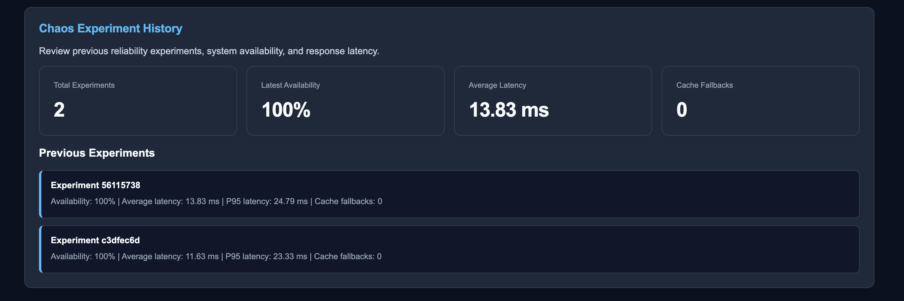
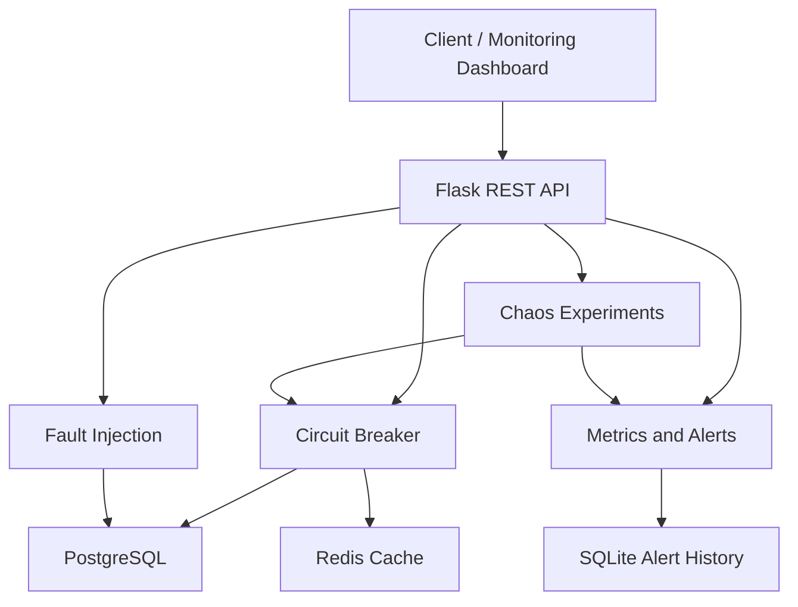

# FaultForge

A fault-tolerant REST API with automated recovery, monitoring, and CI/CD.

FaultForge is a reliability engineering project built with Python and Flask. It demonstrates how backend systems respond to simulated failures using fault injection, circuit breakers, recovery mechanisms, and monitoring.


## Dashboard Preview



### Circuit Breaker in Action





### Monitoring and Experiments





## Features

- REST API built with Flask
- PostgreSQL and Redis integration
- Database fault injection and recovery testing
- Circuit breaker pattern
- Chaos engineering experiments
- API latency monitoring and P95 metrics
- Performance alerts and persistent alert history
- Reliability monitoring dashboard
- Health-check endpoints
- Automated testing and GitHub Actions CI

## System Architecture

FaultForge demonstrates reliability engineering through fault injection, circuit breaking, fallback mechanisms, automated recovery, and observability.



## API Reference

FaultForge exposes REST endpoints for service monitoring, fault injection, chaos experiments, and reliability metrics.


## Reliability Demonstration

FaultForge demonstrates how a backend application can remain available during a simulated database failure by serving cached data from Redis.

### 1. Normal Operation

Request:

```bash
curl http://127.0.0.1:5000/api/services
```

Observed response fields:

```json
{
  "source": "primary",
  "stale": false,
  "system_status": "healthy",
  "cache_status": "available"
}
```

The application retrieves service information from PostgreSQL.

### 2. Simulate a Database Failure

Request:

```bash
curl -X POST http://127.0.0.1:5000/api/simulate-failure
```

Observed response:

```json
{
  "message": "Simulated database failure request completed",
  "request_status": 200,
  "system_status": "degraded",
  "circuit_breaker": {
    "state": "CLOSED",
    "failure_count": 1
  }
}
```

The system detects the simulated failure and records it.

### 3. Verify Redis Fallback

Request:

```bash
curl "http://127.0.0.1:5000/api/services?fail=true"
```

Observed response fields:

```json
{
  "source": "cache",
  "stale": true,
  "system_status": "degraded",
  "cache_status": "available"
}
```

The API continues serving cached service information rather than failing completely.

The response explicitly indicates that the data is stale.

### 4. Verify Recovery

Request:

```bash
curl http://127.0.0.1:5000/api/services
```

Observed response fields:

```json
{
  "source": "primary",
  "stale": false,
  "system_status": "healthy",
  "cache_status": "available"
}
```

Once the simulated failure is no longer applied, the application resumes retrieving data from PostgreSQL.

### 5. Inspect Reliability Metrics

```bash
curl http://127.0.0.1:5000/api/metrics
```

During the demonstration, the cumulative failure counter increased from 1974 to 1976.

The monitoring dashboard is available at:

http://127.0.0.1:5000/dashboard

### Engineering Takeaways

This demonstration illustrates:

- Graceful degradation during dependency failures
- Redis-based fallback when primary database access fails
- Explicit stale-data indicators
- Failure tracking and observability
- Restoration of normal service after a simulated outage

The circuit breaker remained CLOSED during this demonstration; a full circuit-breaker state transition was not tested in this sequence.

### Chaos Engineering Examples

Chaos configuration is intended for local development only.

Both `ENABLE_FAULT_INJECTION` and `CHAOS_API_ENABLED` must be enabled in the Flask application configuration.

**Configure a chaos experiment**

```bash
curl -X POST http://127.0.0.1:5000/api/chaos/configure \
  -H "Content-Type: application/json" \
  -d '{
    "enabled": true,
    "latency_ms": 100,
    "failure_rate": 0.2
  }'
```

Example successful response:

```json
{
  "message": "Chaos configuration updated",
  "enabled": true,
  "latency_ms": 100,
  "failure_rate": 0.2
}
```

**Simulate a database failure**

```bash
curl -X POST http://127.0.0.1:5000/api/simulate-failure
```

This endpoint simulates a failed database request and returns the request result and circuit breaker state.

**Reset chaos configuration**

```bash
curl -X POST http://127.0.0.1:5000/api/chaos/reset
```

Example successful response:

```json
{
  "message": "Chaos experiments disabled",
  "enabled": false,
  "latency_ms": 0,
  "failure_rate": 0.0
}
```

**View experiment history**

```bash
curl http://127.0.0.1:5000/api/chaos/experiments
```

### Safety and Validation

- Chaos configuration and reset are restricted to localhost.
- Chaos operations require explicit configuration flags.
- Invalid JSON or invalid parameter values return HTTP 400.
- Disabled chaos configuration endpoints return HTTP 403.
- Reset chaos configuration after testing.

### Application and Health

| Method | Endpoint | Description |
|---|---|---|
| GET | `/` | Application home |
| GET | `/dashboard` | Reliability monitoring dashboard |
| GET | `/health/live` | Application liveness check |
| GET | `/health/ready` | Application readiness check |
| GET | `/api/health/alert-storage` | SQLite alert storage health check |

### Services and Fault Injection

| Method | Endpoint | Description |
|---|---|---|
| GET | `/api/services` | Retrieve service information |
| POST | `/api/simulate-failure` | Trigger a simulated failure |

### Chaos Engineering

| Method | Endpoint | Description |
|---|---|---|
| POST | `/api/chaos/configure` | Configure fault injection |
| POST | `/api/chaos/reset` | Reset chaos configuration |
| GET | `/api/chaos/experiments` | Retrieve chaos experiment history |

### Monitoring and Metrics

| Method | Endpoint | Description |
|---|---|---|
| GET | `/api/metrics` | Retrieve reliability metrics |
| GET | `/api/metrics/trends` | Retrieve metric trends |
| GET | `/api/monitoring` | Retrieve monitoring information |
| GET | `/api/events` | Retrieve recorded events |
| GET | `/api/metrics/latency` | Retrieve latency metrics |
| GET | `/api/metrics/latency/history` | Retrieve latency history |
| GET | `/api/metrics/latency/alert` | Evaluate the current latency alert |
| GET | `/api/metrics/latency/alerts/history` | Retrieve persistent alert history |

### Example Requests

Check application liveness:

```bash
curl http://127.0.0.1:5000/health/live
```

Example response:

```json
{
  "service": "faultforge",
  "status": "alive"
}
```

Check persistent alert storage:

```bash
curl http://127.0.0.1:5000/api/health/alert-storage
```

Example healthy response:

```json
{
  "database": "sqlite",
  "service": "alert_storage",
  "status": "healthy"
}
```

Retrieve latency metrics:

```bash
curl http://127.0.0.1:5000/api/metrics/latency
```

Retrieve the latest 10 alert transitions:

```bash
curl "http://127.0.0.1:5000/api/metrics/latency/alerts/history?limit=10"
```

Filter alert transitions by status:

```bash
curl "http://127.0.0.1:5000/api/metrics/latency/alerts/history?status=critical"
```

### HTTP Status Codes

- `200 OK`: Successful request or healthy service.
- `400 Bad Request`: Invalid input on endpoints that validate request parameters.
- `503 Service Unavailable`: Alert storage health check failed.

POST endpoint request bodies and additional response formats are documented separately after implementation verification.

### Component Responsibilities

- **Flask REST API:** Handles incoming HTTP requests and exposes monitoring endpoints.
- **Circuit Breaker:** Prevents repeated database requests during failures and supports recovery.
- **Fault Injection:** Simulates database failures to test application resilience.
- **PostgreSQL:** Provides the primary database service.
- **Redis:** Supports caching and fallback behavior.
- **Metrics and Alerts:** Tracks request latency, P95 performance, and alert transitions.
- **SQLite:** Persists alert history across application restarts.
- **Chaos Experiments:** Exercises failure and recovery scenarios and collects reliability measurements.

## Technology Stack

- Python 3.12
- Flask
- PostgreSQL 16
- Redis 7
- SQLite (persistent alert history)
- Docker Compose
- pytest and pytest-cov
- GitHub Actions

## Prerequisites

Install the following before running FaultForge:

- Python 3.12
- Docker Desktop
- Git

## Quick Start

### 1. Clone the repository

```bash
git clone https://github.com/cowboytrex/FaultForge.git
cd FaultForge
```

### 2. Create a virtual environment

```bash
python3.12 -m venv .venv
source .venv/bin/activate
```

### 3. Install dependencies

```bash
python -m pip install -r requirements.txt
```

### 4. Configure environment variables

```bash
cp .env.example .env
```

Open `.env` and replace the example PostgreSQL password with a local development password.

Never commit `.env` to Git.

### 5. Start PostgreSQL and Redis

```bash
docker compose up -d
docker compose ps
```

Wait until both services report `healthy`.

### 6. Start the Flask application

```bash
PYTHONPATH=backend:. python -m flask --app backend.app run --port 5000
```

### 7. Open the monitoring dashboard

Visit:

http://127.0.0.1:5000/dashboard

## Health Checks

Application liveness:

```bash
curl http://127.0.0.1:5000/health/live
```

Alert storage health:

```bash
curl http://127.0.0.1:5000/api/health/alert-storage
```

The alert storage endpoint returns HTTP 503 if its health check fails.

## Running Tests

Run the unit test suite:

```bash
PYTHONPATH=backend:. python -m pytest -q -m "not integration"
```

Run tests with coverage:

```bash
PYTHONPATH=backend:. python -m pytest -q -m "not integration" --cov=backend --cov-report=term-missing --cov-fail-under=85
```

## Stop Services

Stop Flask with Ctrl+C in its terminal.

Stop PostgreSQL and Redis:

```bash
docker compose down
```

This preserves the PostgreSQL Docker volume.

## Development and Deployment Notes

- Docker Compose currently runs PostgreSQL and Redis.
- The Flask application runs locally in a Python virtual environment.
- SQLite stores persistent performance alert history in `data/alerts.db`.
- Local environment variables are stored in `.env`, which is excluded from Git.
- Flask's development server is not intended for production deployment.
- This repository is a reliability engineering demonstration, not a production-hosted service.

## License

See [LICENSE](LICENSE).
